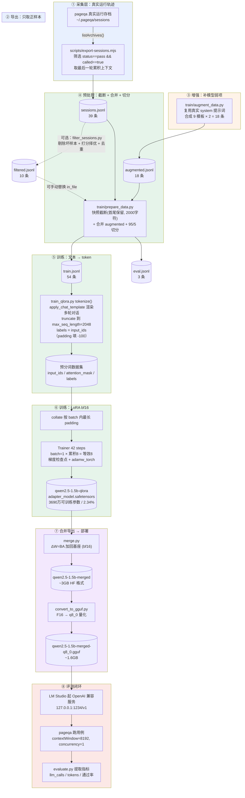
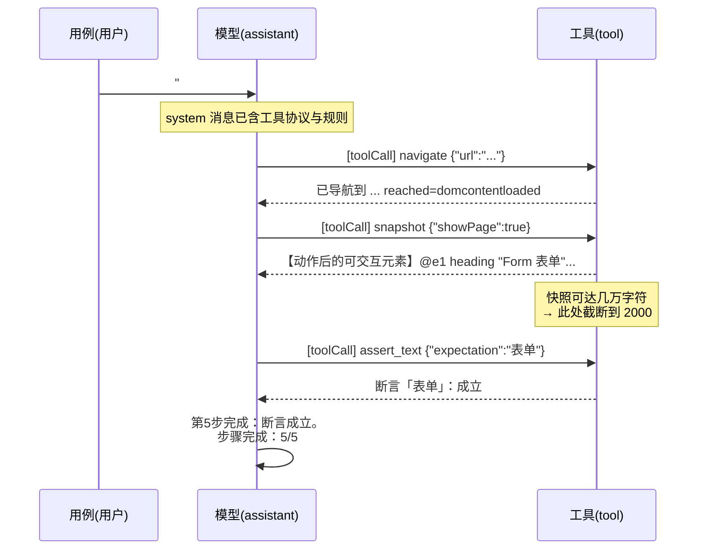

# pageqa 专用模型训练原理

本文说明如何把 pageqa（浏览器自动化测试 agent）的运行轨迹，微调成一个"又快又准"的 1.5B 小模型，让它在本机 8GB 显存上就能稳定驱动浏览器执行用例。

---

## 1. 整体目标与思路

**要解决什么问题**

pageqa 是一个让 LLM 驱动浏览器的测试 agent：读用例 → 调工具（`navigate` / `snapshot` / `click` / `assert_text`…）→ 判断结果。通用大模型能跑，但有两个痛点：

1. **慢**：每一步都要把整页 aria 快照重新喂给模型，上下文巨大、往返次数多。
2. **贵/难部署**：依赖云端 API，数据出境，且本地根本跑不动大模型。

**思路**

用 pageqa **自己跑出来的成功轨迹**做监督微调（SFT），训练一个只懂 pageqa 这套工具协议的小模型。因为任务边界极窄（只会调这几个工具），1.5B 就够用；又因为训练数据就是 pageqa 真实分布的上下文，模型能学会"看快照 → 精准选元素 → 立刻断言"，从而**减少 LLM 往返、缩短上下文**。

**一句话**：*把"会开车的通用大模型"，微调成"只开这条路、且开得熟练的 1.5B 司机"。*

---

## 2. 数据从哪来（真实轨迹 → 训练集）

关键洞察：**训练数据不用手写，从 pageqa 自己的成功运行里"抄"**。

### 2.0 全链路数据流图



> 实线 = 主链路；虚线 = 可选分支。条数为当前实际数据量：`39 + 18 = 57` → `train 54 / eval 3`。

### 2.0.1 各阶段产物一览

| 阶段 | 脚本 | 产物 | 条数 | 说明 |
|---|---|---|---|---|
| 采集 | pageqa 自身 | `~/.pageqa/sessions` | — | 运行时的会话存档 |
| 导出 | `export-sessions.mjs` | `sessions.jsonl` | 39 | 只含 `pass` 且已调用模型的运行 |
| 过滤（可选） | `filter_sessions.py` | `filtered.jsonl` | 10 | 「快而准」短路径；**默认不接主链路**，需手动把 `in_file` 指向它 |
| 增强 | `augment_data.py` | `augmented.jsonl` | 18 | 强化 `assert_text` 与步骤完成度 |
| 预处理 | `prepare_data.py` | `train.jsonl` / `eval.jsonl` | 54 / 3 | 截断 + 合并 + 95/5 切分 |
| 训练 | `train_qlora.py` | `qwen2.5-1.5b-qlora` | 42 steps | LoRA 适配器 |
| 合并 | `merge.py` | `qwen2.5-1.5b-merged` | — | bf16 完整模型 |
| 量化 | `convert_to_gguf.py` | `...-q8_0.gguf` | — | 部署产物 |

### 2.0.2 单条轨迹的数据形态

一条轨迹 = 一条多轮对话（`messages` 数组），这是 pageqa 实际发给模型的上下文：



其中 `assistant` 的动作以 `[toolCall] <工具名> <JSON 参数>` 文本行存储（见 `src/session/archive.ts`），`tool` 消息是执行结果（带 `[tool-ok]` / `[tool-error]` 标记）——这个格式是 pageqa 自己的协议，也是模型要学会"生成"的目标格式。

---

### 2.1 原始链路（文字版）

```
pageqa 真实运行（本地存档）
    ↓  scripts/export-sessions.mjs        只导出 status==pass 且 called==true 的运行
sessions.jsonl                           （失败轨迹留给未来做 DPO 负例）
    ↓  train/filter_sessions.py           剔除坏样本 + 打分排序 + 去重
filtered.jsonl                            「快而准」的短路径
    ↓  train/augment_data.py              合成强化 assert_text 的轨迹
augmented.jsonl
    ↓  train/prepare_data.py              快照截断 + 合并增强数据 + 95/5 切分
train.jsonl / eval.jsonl
```

### 2.1 export-sessions.mjs —— 抽取正样本

- 只取 `status === "pass" && called === true` 的运行，天然是干净正样本。
- 取"最后一轮"的累积上下文作为一条多轮对话：`system`（工具协议与规则）+ `user`（用例步骤）+ `assistant`（`[toolCall] 工具名 参数`）+ `tool`（执行结果）。

### 2.2 filter_sessions.py —— 质量过滤（让模型学"好习惯"）

在已 pass 的基础上进一步"择优"，规则直接对应"识别速度"：

| 处理 | 判定 | 原因 |
|---|---|---|
| **丢弃** | 用了 `wait(ms)` 猜秒数 | 应改用 `wait_for` 条件等待 |
| **丢弃** | 同一动作连续出现 ≥3 次 | 卡顿 / 重试迹象，走弯路 |
| **丢弃** | 工具结果含 `[tool-error]` 等错误标记 | 过程有失败 |
| **打分 +2** | 用 `select_option` / `pick_date` | 塌缩型单调用，一步到位，快 |
| **打分 −1** | 每次 `snapshot` | 快照往返越多越慢 |
| **去重** | 「用例文本 + 动作序列」哈希 | 去重复/近似重复 |

打分 `score = 2×塌缩调用数 − 1×快照数`，按分数从高到低排序，默认保留前 60%。**这样训练集里的每条轨迹都是"短路径、快而准"的示范**。

### 2.3 augment_data.py —— 强化弱项（可选增强）

1.5B 模型有个通病：会 `navigate` + `snapshot`，却**不调 `assert_text`** 就直接写"步骤完成"，导致断言 0 条、场景判失败。这个脚本复用真实数据里的系统提示词与消息风格，手工构造一批"正确轨迹"，每条都明确演示：

- 每个"断言 …"步骤都真的调一次 `[toolCall] assert_text {...}`；
- 每完成一步输出"第 k 步完成：…"；
- 结尾单独输出"步骤完成：k/n"；
- 交互动作（`fill` / `select_option` / `pick_date` / `click`）做完后才断言，不提前收尾。

覆盖 9 种场景模板 ×2 份 = 18 条，输出到 `augmented.jsonl`。

> 设计要点：`augmented.jsonl` 是**独立持久化文件**。因为 `export-sessions.mjs` 每次会**覆盖** `sessions.jsonl`，若把合成数据直接追加进去，下次导出会被抹掉。所以 `prepare_data.py` 会主动合并 `augmented.jsonl`，两者解耦、不会重复计数。

### 2.4 prepare_data.py —— 截断 + 切分

- **快照截断（关键）**：pageqa 的 aria 快照动辄几万字符，不截断直接撑爆显存。只对 `user`/`tool` 消息截断，采用**保留首尾**策略（尾部常是 `showPage` 追加的可交互元素清单，对识别最有价值），默认 `max_snapshot_chars=2000`，并在截断处标注原长度便于核对。
- **合并增强数据**：并入 `augmented.jsonl`。
- **95/5 切分**：`seed=42` 固定随机，按 `eval_split=0.05` 产出 `train.jsonl` / `eval.jsonl`。

---

## 3. 模型与训练（LoRA 微调 1.5B）

基座：`Qwen/Qwen2.5-1.5B-Instruct`。为什么选它——pageqa 工具协议简单、上下文被截到 2K，1.5B 有足够容量；且本机 8GB 显存跑得动。

### 3.1 为什么用 LoRA（而不是全量微调）

全量微调 1.5B 需要存优化器状态，显存远超 8GB。LoRA 的做法是**冻结基座，只训练注入到线性层的小适配器**：

- 可训练参数仅 **3690 万**（约占全部 15.8 亿参数的 **2.34%**）；
- 梯度、优化器状态、模型副本都只为这 3690 万服务 → 显存极小；
- 合并时把 `ΔW = BA` 加回原权重，不改变基座结构。

配置（`config.yaml → lora`）：`r=32`、`lora_alpha=64`、`lora_dropout=0.05`，挂在 Qwen2 全部 7 个线性投影层（`q/k/v/o_proj`、`gate/up/down_proj`）。

### 3.2 显存策略（8GB 本机）

峰值显存是训练能否跑起来的关键，本项目用几件事把它压进 8GB：

- **序列截断**：`max_seq_length=2048`（`prepare_data` 已把快照压到 2000 字符，`tokenize` 再按 token 封顶）。
- **batch=1 + 梯度累积 8**：单卡一次只放 1 条，用累积模拟等效 batch 8，稳定且省显存。
- **梯度检查点**（`gradient_checkpointing: true`）：用时间换显存，激活值大幅减少。
- **fp16/bf16 + 梯度累积**：配合 `bf16: true`。

> 注：本机（RTX 5060 Laptop 8GB）在"4-bit 加载 + 分页优化器"组合下会在训练第 0 步触发 bitsandbytes 初始化失败（`pythonInterface.cpp:559`）。经独立脚本验证 bnb 本身可用，故 `config.yaml` 已改为**纯 bf16 路径**：`load_in_4bit: false` + `optim: adamw_torch`，训练不依赖 bitsandbytes。fp16/bf16 分支刻意避开 `device_map="auto"`，避免 accelerate 触发 bnb 探测。

### 3.3 tokenize 与 collate（SFT 的关键细节）

- **渲染 chat 模板**：`tokenizer.apply_chat_template(messages)` 把多轮对话渲染成带特殊 token 的训练文本。
- **labels = input_ids**（不做指令 masking）：让模型同时学会"读上下文"和"生成下一个动作/文本"。padding 位置填 `-100`，不参与 loss。
- **自写 collate**：按 batch 内最长序列 padding（`input_ids` 补 `pad_id`、`attention_mask` 补 0、`labels` 补 `-100`），避免依赖各版本 `SFTTrainer` 的参数改名。
- **版本兜底**：用 `inspect.signature` 过滤当前 `transformers` 版本 `TrainingArguments` 不支持的键，防止版本差异直接崩溃。
- **续训支持**：脚本自动发现 `checkpoint-*` 并 `resume_from_checkpoint`，长时间被中断后可重复执行接着跑，不必从头。

---

## 4. 合并与导出（把适配器变成可部署模型）

训练产物是"基座 + 适配器"，部署需要单个模型文件，两步：

### 4.1 merge.py —— 合并回基座

- 基座以 **bf16** 载入（不能在 4-bit 上直接 merge），挂上 LoRA 后 `merge_and_unload()`，`ΔW = BA` 加回原权重；
- 落盘为 bf16 完整模型（约 3GB）到 `qwen2.5-1.5b-merged`。

### 4.2 convert_to_gguf.py —— 转 GGUF 并量化

供 LM Studio / llama.cpp 加载，流程：准备 llama.cpp 的 `convert_hf_to_gguf.py` → 转 F16 GGUF → 量化（默认 `q8_0`，约 1.6GB）。

> 本项目 LM Studio 直接加载 `train/outputs/gguf/qwen2.5-1.5b-merged-q8_0.gguf`，转换产物即部署产物，转换后**在 LM Studio 重新加载同路径模型**即可，无需拷贝。

---

## 5. 部署与评测闭环

### 5.1 启动推理服务

用 LM Studio / llama.cpp / vLLM 把 GGUF 以 **OpenAI 兼容**方式起服务（如 `http://127.0.0.1:1234/v1`）。

### 5.2 pageqa 接入与关键配置（`~/.pageqa/config.json`）

| 配置 | 值 | 原因 |
|---|---|---|
| `contextWindow` | `8192` | **必须显式声明**。模型元数据自称 32768，但引擎真实 `n_ctx` 仅约 8192；声明后 pageqa 进入"小窗口模式"，自动压缩固定前缀、瘦身快照——也正好匹配训练时 2000 字符快照的分布 |
| `concurrency` | `1` | 本地小引擎扛不住多场景并行各自的 ~8K 上下文，并行会被拒成溢出；串行后彻底消除溢出 |

### 5.3 evaluate.py —— 用 pageqa 当评测

跑一次真实用例并产出指标 JSON（`run` 子命令），再对比训练前后（`compare` 子命令）。关键指标：

- `llm_calls`：LLM 往返次数（越少 = 识别越快、少走弯路）；
- `input_tokens` / `output_tokens` / `tokens_per_step`：单轮上下文与生成量；
- `cache_read`：提示缓存命中（越高 = 前缀越稳定）；
- `status` / `scenarios_pass` / `scenarios_fail` / `assertions_*`：准确率（**速度不能牺牲准确率**）。

评测时 pageqa 以 `--json --usage-stream` 运行，`evaluate.py` 从 stderr 的 `[pageqa:usage]` 行取用量、从 stdout 取报告 JSON。

---

## 6. 一键脚本 run_pipeline.ps1

串联"清理旧产物 → 训练（带续跑）→ merge → 转 GGUF"：

```powershell
powershell -ExecutionPolicy Bypass -File train/run_pipeline.ps1
```

- **续跑循环**：若训练中断（未写出最终 `adapter_model.safetensors`），自动重跑并从最近 checkpoint 续训，直到训练完成；
- **注意**：请在**普通终端**运行。若在会强杀长命令的托管环境里跑，训练被打断会泄漏 CUDA 上下文，导致后续续跑失败。

---

## 7. 文件导航

| 文件 | 职责 |
|---|---|
| `train/config.yaml` | 唯一配置源：模型 / 精度 / LoRA / 数据 / 超参 / 合并 / 评测 |
| `train/prepare_data.py` | 快照截断 + 合并增强数据 + 95/5 切分 |
| `train/filter_sessions.py` | 轨迹质量过滤、打分、去重 |
| `train/augment_data.py` | 合成强化 `assert_text` 的轨迹 |
| `train/train_qlora.py` | LoRA 训练（tokenize、collate、续训） |
| `train/merge.py` | LoRA 合并回基座（bf16） |
| `train/convert_to_gguf.py` | 转 GGUF + 量化 |
| `train/evaluate.py` | pageqa 评测闭环与前后对比 |
| `train/run_pipeline.ps1` | 训练→合并→转 GGUF 一键脚本 |
| `scripts/export-sessions.mjs` | 从 pageqa 存档导出 pass 轨迹 |

---

## 8. 完整命令速查

```bash
# 0) 安装依赖（torch 必须是 CUDA 版，Blackwell 用 cu128+）
pip install -r train/requirements.txt

# 1) 导出真实轨迹（只导 pass）
pnpm build
node scripts/export-sessions.mjs --out train/data/sessions.jsonl

# 2) 质量过滤 + 去重（可选但推荐）
python train/filter_sessions.py

# 3) 合成强化 assert_text 的轨迹（可选）
python train/augment_data.py

# 4) 预处理：截断 + 合并 + 切分
python train/prepare_data.py --config train/config.yaml

# 5) 训练
python train/train_qlora.py --config train/config.yaml

# 6) 合并 + 转 GGUF（或直接 run_pipeline.ps1 一次搞定 5~7）
python train/merge.py --config train/config.yaml
python train/convert_to_gguf.py --quant q8_0

# 7) 起推理服务后，评测
pageqa examples/element-plus-form.md --no-tui
python train/evaluate.py run --config train/config.yaml \
  --base-url http://127.0.0.1:1234/v1 --model qwen2.5-1.5b-merged \
  --out train/outputs/metrics/finetuned.json
python train/evaluate.py compare \
  --baseline train/outputs/metrics/baseline.json \
  --finetuned train/outputs/metrics/finetuned.json
```

---

## 9. 设计取舍备忘

- **为什么截断保留首尾而非直接切片**：aria 快照尾部是 `showPage` 的可交互元素清单，对"该点哪个元素"最关键，直接切片会把它切掉。
- **为什么 labels 不做指令 masking**：目标是让模型学会"读上下文 + 生成动作"，全序列参与 loss 更契合这个目标。
- **为什么强制声明 `contextWindow=8192`**：模型元数据不可信（自称 32768，实际 8192）。声明真实值才能触发小窗口模式，避免"上下文溢出"这个头号杀手。
- **为什么合成数据独立成文件**：避免被 `export-sessions.mjs` 的覆盖行为抹掉，也避免重复计数。
- **1.5B 的先天局限**：多步工具调用的"指令遵循"较弱（如漏调 `assert_text`）。根本解法是换更大基座（3B/7B，同一条 pipeline 直接可用，需 ≥12GB 显存）或继续补数据；增强数据 + 更多 epoch 只能部分缓解。